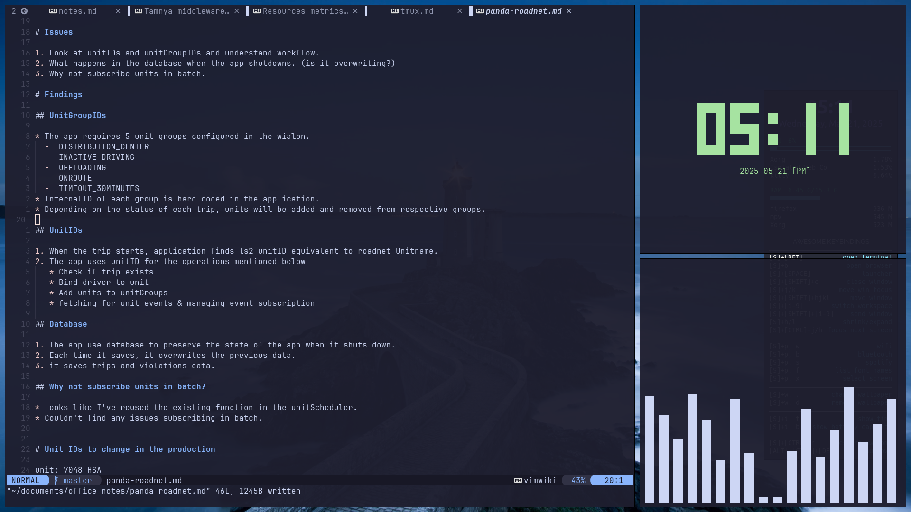

# dotfiles

[](https://github.com/prakhil-tp/dotfiles/search?l=vim%20script)
[](https://github.com/prakhil-tp/dotfiles/tags)
[](https://github.com/Prakhil-tp/dotfiles/commits/master)



Configuration files  to customize Linux or unix-like systems. 

## Configs

- [Alacritty](https://github.com/Prakhil-tp/dotfiles/tree/master/alacritty/.config/alacritty)
- [Alacritty (ThinkPad)](https://github.com/Prakhil-tp/dotfiles/tree/master/alacritty-thinkpad/.config/alacritty)
- [Anti-freeze](https://github.com/Prakhil-tp/dotfiles/tree/master/anti-freeze)
- [Applications](https://github.com/Prakhil-tp/dotfiles/tree/master/applications)
- [Atuin](https://github.com/Prakhil-tp/dotfiles/tree/master/atuin/.config/atuin)
- [Awesome WM](https://github.com/Prakhil-tp/dotfiles/tree/master/awesome/.config/awesome)
- [Bash](https://github.com/Prakhil-tp/dotfiles/tree/master/bash/)
- [Bat](https://github.com/Prakhil-tp/dotfiles/tree/master/bat/.config/bat/)
- [Conky](https://github.com/Prakhil-tp/dotfiles/tree/master/conky/.config/conky/)
- [Devilspie 2](https://github.com/Prakhil-tp/dotfiles/tree/master/devilspie2/.config/devilspie2/)
- [Dm-scripts](https://github.com/Prakhil-tp/dotfiles/tree/master/dm-scripts/scripts)
- [Doom Emacs](https://github.com/Prakhil-tp/dotfiles/tree/master/emacs/)
- [Dunst](https://github.com/Prakhil-tp/dotfiles/tree/master/dunst-notificaiton/.config/dunst/)
- [Env](https://github.com/Prakhil-tp/dotfiles/tree/master/env/)
- [Firefox](https://github.com/Prakhil-tp/dotfiles/tree/master/firefox/)
- [Fontconfig](https://github.com/Prakhil-tp/dotfiles/tree/master/fontconfig/.config/fontconfig)
- [Fzf](https://github.com/Prakhil-tp/dotfiles/tree/master/fzf/.local/share/fzf)
- [Git](https://github.com/Prakhil-tp/dotfiles/tree/master/git/.config/git)
- [Htop](https://github.com/Prakhil-tp/dotfiles/tree/master/htop/.config/htop)
- [Keyboard Interception](https://github.com/Prakhil-tp/dotfiles/tree/master/keyboard-interception/interception)
- [Kitty](https://github.com/Prakhil-tp/dotfiles/tree/master/kitty/.config/kitty)
- [Lightdm](https://github.com/Prakhil-tp/dotfiles/tree/master/lightdm/)
- [Lsd](https://github.com/Prakhil-tp/dotfiles/tree/master/lsd/.config/lsd)
- [Mpv](https://github.com/Prakhil-tp/dotfiles/tree/master/mpv/.config/mpv)
- [Mutt](https://github.com/Prakhil-tp/dotfiles/tree/master/mutt/.config/mutt/)
- [Neovim](https://github.com/Prakhil-tp/dotfiles/tree/master/nvim/.config/nvim/)
- [Newsboat](https://github.com/Prakhil-tp/dotfiles/tree/master/newsboat/.config/newsboat)
- [Npm](https://github.com/Prakhil-tp/dotfiles/tree/master/npm/.config/npm)
- [Nvm](https://github.com/Prakhil-tp/dotfiles/tree/master/nvm/)
- [Picom](https://github.com/Prakhil-tp/dotfiles/tree/master/picom/.config/picom)
- [Profile](https://github.com/Prakhil-tp/dotfiles/tree/master/profile/)
- [Qutebrowser](https://github.com/Prakhil-tp/dotfiles/tree/master/qutebrowser/.config/qutebrowser)
- [Remote-machine-zsh](https://github.com/Prakhil-tp/dotfiles/tree/master/remote-machine-zsh/)
- [Rofi](https://github.com/Prakhil-tp/dotfiles/tree/master/rofi/.config/rofi)
- [Systemd](https://github.com/Prakhil-tp/dotfiles/tree/master/systemd/.config/systemd)
- [Tabliss](https://github.com/Prakhil-tp/dotfiles/tree/master/tabliss-browser-extension/)
- [Tmux](https://github.com/Prakhil-tp/dotfiles/tree/master/tmux/)
- [Torrra](https://github.com/Prakhil-tp/dotfiles/tree/master/torrra/.config/torrra)
- [Ufetch](https://github.com/Prakhil-tp/dotfiles/tree/master/ufetch)
- [Vifm](https://github.com/Prakhil-tp/dotfiles/tree/master/vifm/.config/vifm/)
- [X11](https://github.com/Prakhil-tp/dotfiles/tree/master/X11/.config/X11)
- [Xmonad](https://github.com/Prakhil-tp/dotfiles/tree/master/xmonad/.xmonad)
- [Xterm](https://github.com/Prakhil-tp/dotfiles/tree/master/xterm/)
- [Zathura](https://github.com/Prakhil-tp/dotfiles/tree/master/zathura/.config/zathura)
- [Zsh](https://github.com/Prakhil-tp/dotfiles/tree/master/zsh/)

## How to use

1. Clone the repository to home directory
2. Let the `stow` to do the job. (stow will create corresponding config symlinks in appropriate directories.)

``` sh
git clone https://github.com/Prakhil-tp/dotfiles.git
cd ./dotfiles
stow <directory-name>      #  add a particular config. example: $ stow alacritty
```

